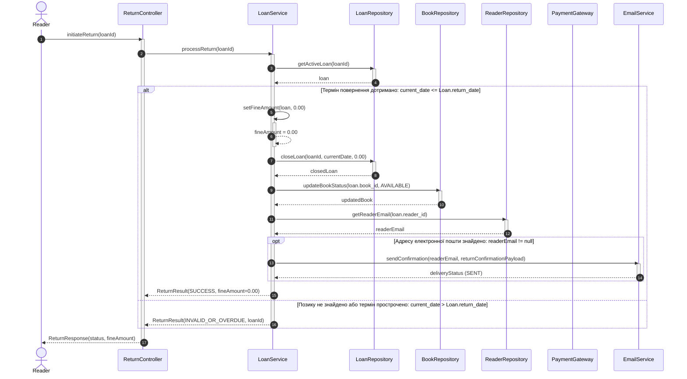
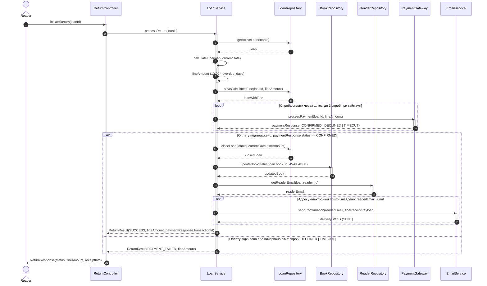
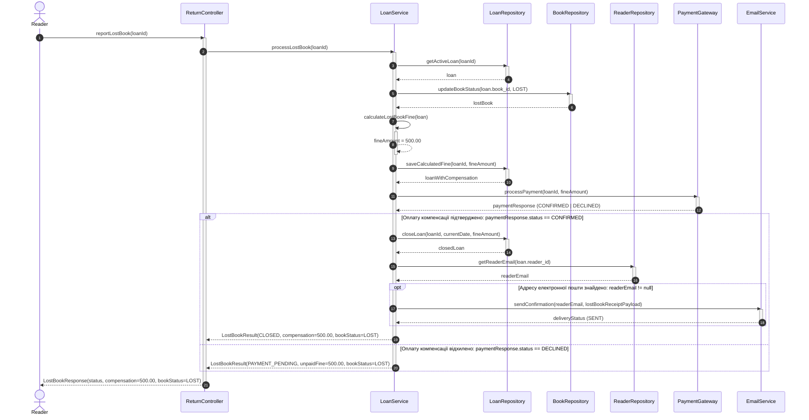

# Sequence-діаграми взаємодії для прецеденту `UC_Return`

Документ описує внутрішню взаємодію компонентів системи управління бібліотекою та зовнішніх сервісів для трьох сценаріїв повернення книги (`UC_Return`), включно з перевіркою статусу позики (`UC_CheckLoanStatus`), оплатою штрафів/компенсацій (`UC_PayFine`) та надсиланням сповіщень (`UC_SendNotification`).

## Учасники взаємодії

1. `Reader` — зовнішній актор (читач), який ініціює повернення книги або повідомляє про її втрату.
2. `ReturnController` — контролер вхідних запитів від клієнтського інтерфейсу.
3. `LoanService` — сервіс бізнес-логіки перевірки термінів, нарахування штрафів, координації оплат та закриття позик.
4. `LoanRepository` — репозиторій сутності `Loan (id, reader_id, book_id, borrow_date, return_date, fine_amount)`.
5. `BookRepository` — репозиторій сутності `Book (id, title, publication_year, status [AVAILABLE, LOANED, LOST])`.
6. `ReaderRepository` — репозиторій сутності `Reader (id, email, full_name)`.
7. `PaymentGateway` — зовнішній платіжний шлюз для проведення транзакцій.
8. `EmailService` — зовнішній поштовий сервіс для відправки підтверджень та квитанцій.

## 1. Сценарій 1: Вчасне повернення книги

Читач ініціює повернення книги, а контролер передає запит у спільний метод `LoanService.processReturn(loanId)`. Після отримання даних позики сервіс перевіряє термін (`current_date <= Loan.return_date`), залишає штраф нульовим (`0.00 грн`), переводить примірник у статус `AVAILABLE` та надсилає лист-підтвердження на електронну пошту читача (за її наявності).

## 2. Сценарій 2: Повернення книги з простроченням та оплатою штрафу

Контролер викликає спільний метод `LoanService.processReturn(loanId)`. Виявивши прострочення (`current_date > Loan.return_date`), сервіс обчислює пеню (`10.00 грн * overdue_days`), зберігає її в `Loan.fine_amount` та здійснює прямий запит на оплату до `PaymentGateway` із циклом повторних спроб при таймауті (до 3 спроб). Після підтвердження платежу позика закривається, книга повертається в статус `AVAILABLE`, а на пошту читача (за наявності `Reader.email`) надсилається квитанція.

## 3. Сценарій 3: Повідомлення про втрату книги з компенсацією

Читач повідомляє про втрату книги (`reportLostBook(loanId)`). Система негайно переводить примірник у статус `LOST`, розраховує фіксовану компенсацію `500.00 грн` (перекриваючи можливу пеню за прострочення) та зберігає її в `Loan.fine_amount`. Після проведення оплати через `PaymentGateway` позика закривається (книга залишається у статусі `LOST`), а підтвердження надсилається на `Reader.email` за наявності адреси.

